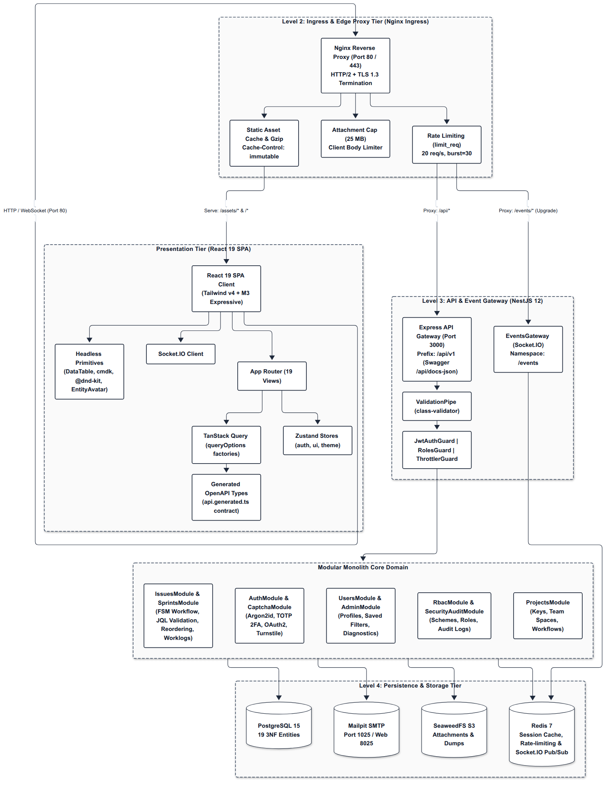
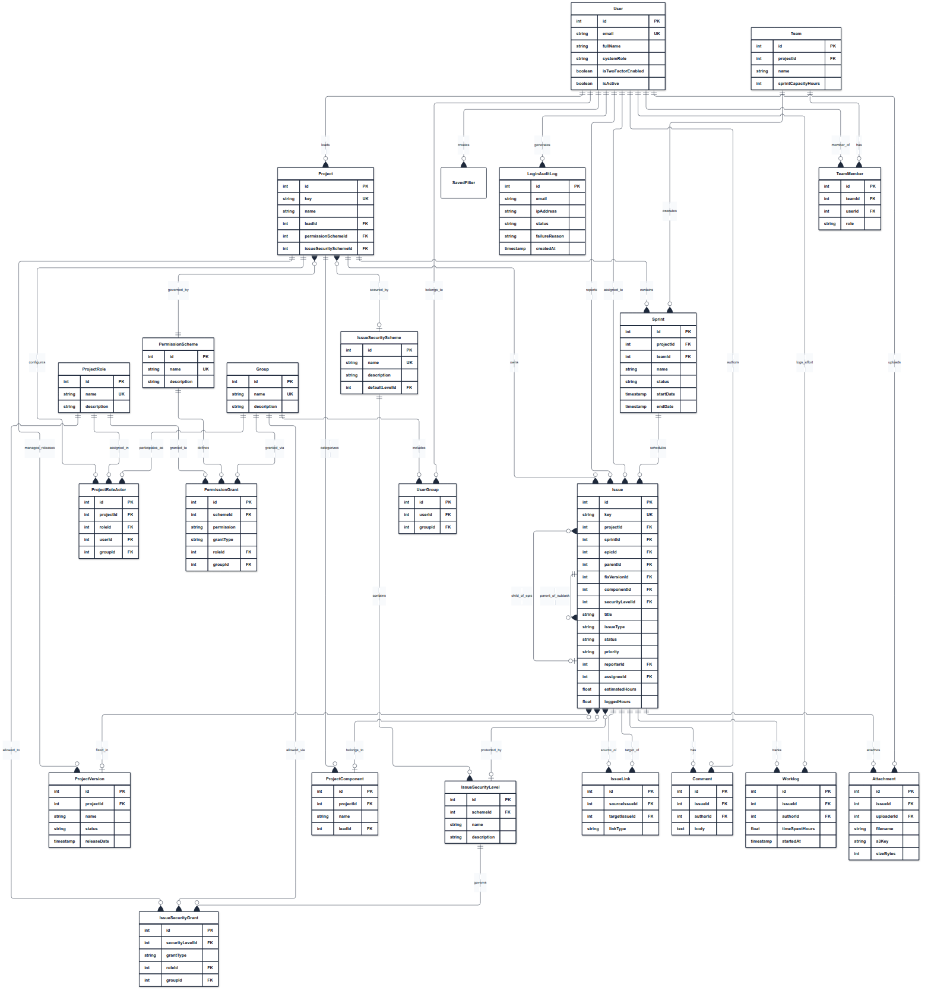
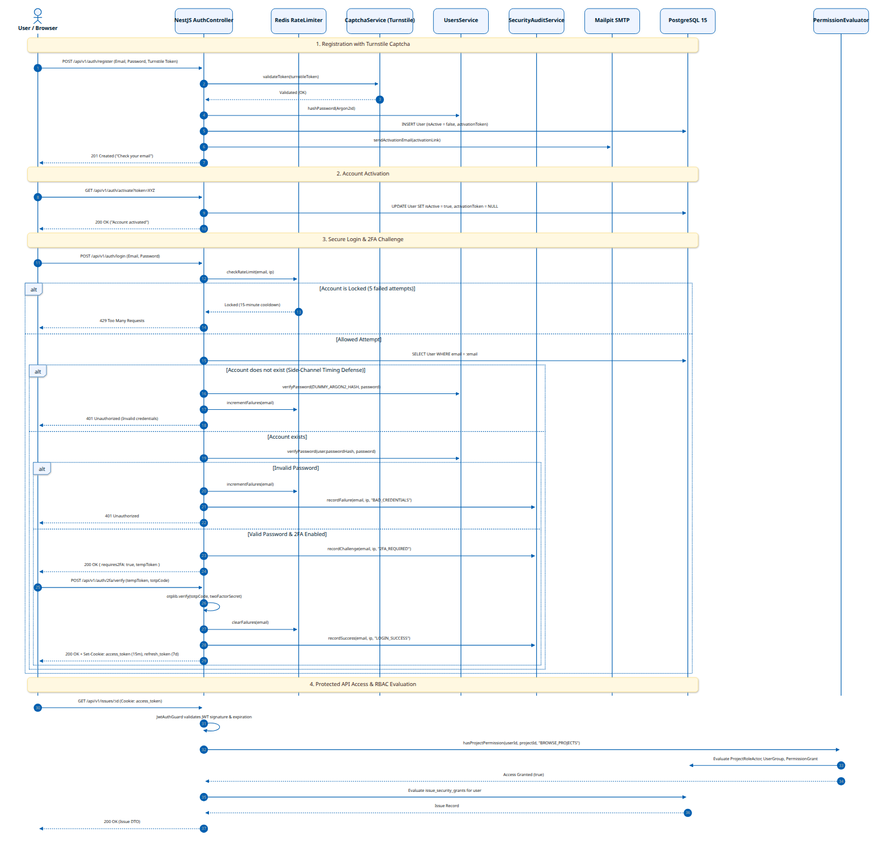
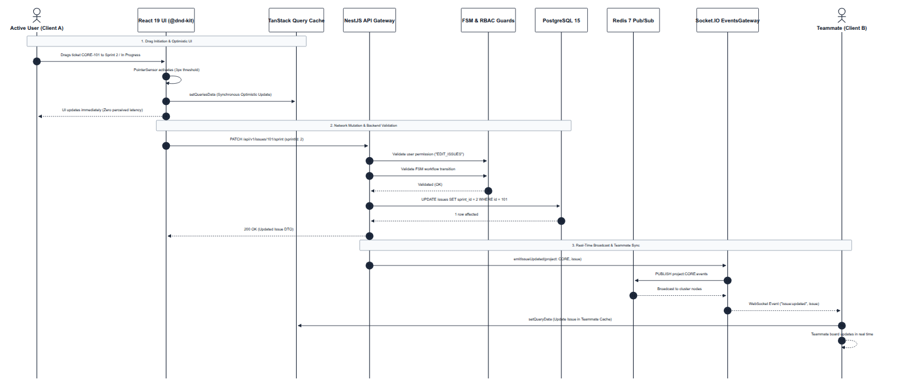
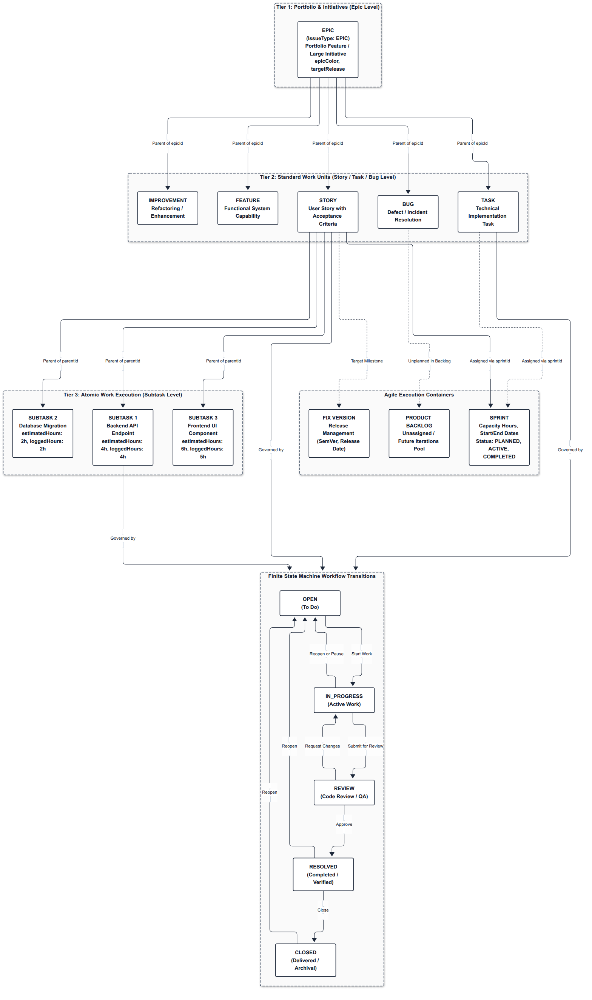
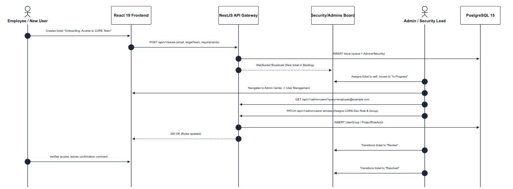

# System Architecture and Technical Specification

This document describes the technical architecture of the BugTracker software.
The text uses the ASD-STE100 Simplified Technical English specification.

---

## 1. System Purpose and Scope

BugTracker is an enterprise issue tracking and project management system.
The system provides agile backlog planning, Kanban boards, role-based access control, and time tracking.
The software is designed for ten thousand or more active users.
All business rules and security checks execute on the backend server.
The frontend user interface only shows data and captures user input.

---

## 2. High-Level System Architecture

The software uses a four-tier modular architecture.

1. **Client Tier**: A React 19 Single Page Application runs in modern web browsers.
2. **Ingress and Edge Tier**: An Nginx reverse proxy terminates Transport Layer Security (TLS) connections and limits request rates.
3. **Application Gateway Tier**: A NestJS 12 modular application server processes business logic and serves HTTP and WebSocket requests.
4. **Persistence Tier**: A PostgreSQL database, a Redis cache, and a SeaweedFS object store keep persistent data.

### System Architecture Diagram



---

## 3. Technology Stack and Network Endpoints

The table below lists all runtime services, software technologies, network ports, and primary roles.

| Layer | Technology | Network Port | Primary Role |
|---|---|---|---|
| Ingress Proxy | Nginx Alpine | 80 (HTTP), 443 (TLS) | Routes network traffic, limits IP request rates, and caches static assets. |
| Application API | NestJS 12, Node.js 24 | 3000 (`/api/v1`) | Executes domain business logic, validates input data, and issues tokens. |
| Real-Time Gateway | Socket.IO | 3000 (`/events`) | Sends live project events to connected browser sessions. |
| Frontend Web Client | React 19, Vite 8, Tailwind v4 | 5173 | Renders user interface components and captures user actions. |
| Relational Database | PostgreSQL 15 | 5432 | Stores relational data across nineteen normalized database tables. |
| Distributed Cache | Redis 7 | 6379 | Keeps session locks, counts failed logins, and distributes WebSocket events. |
| Object Storage | SeaweedFS S3 | 8333 (S3 API), 9333 (Master) | Stores file attachments, user avatar images, and system export archives. |
| Mail Server (Dev) | Mailpit | 1025 (SMTP), 8025 (Web UI) | Receives account activation emails and password reset messages. |

---

## 4. Presentation Tier Architecture (Frontend)

The frontend application uses modern web libraries and design guidelines.

### 4.1 Core Libraries

- **Framework**: React 19 with functional components and TypeScript strict mode.
- **Build Tool**: Vite 8 with hot module replacement.
- **Styles**: Tailwind CSS version 4 with Material Design 3 Expressive CSS variables.
- **Server Cache**: TanStack Query version 5 for data caching, deduplication, and optimistic updates.
- **Local State**: Zustand version 5 for UI preferences, auth state, and multi-issue selection.
- **Drag and Drop**: `@dnd-kit/core` with coordinate sensors and zero layout shift.
- **Data Tables**: `@tanstack/react-table` with `@tanstack/react-virtual` row virtualization.

### 4.2 Presentation Design Rules

- The frontend never calculates business metrics or permissions.
- The frontend calls backend REST endpoints for all data filtering and sorting.
- User interface colors must use CSS variables from `src/index.css`.
- Interactive components use headless primitives from `src/components/ui/`.
- Drag operations update local cache optimistically and send asynchronous API mutations.

---

## 5. Application Tier Architecture (Backend Monolith)

The backend uses NestJS 12 in a modular monolith structure.

### 5.1 Request Processing Pipeline

1. **Global Pipes**: `ValidationPipe` validates all input transfer objects with `class-validator`.
2. **Security Guards**:
   - `JwtAuthGuard` checks the signature and expiration time of access tokens.
   - `RolesGuard` checks system administrator privileges.
   - `ProjectPermissionGuard` checks project role permissions before method execution.
3. **Rate Limiting**: `LoginRateLimiterService` uses Redis to block brute-force login attacks.
4. **Controllers**: Controllers map HTTP paths to service method calls.
5. **Services**: Services execute transactional domain logic and database queries.
6. **Exception Filters**: Global exception filters convert NestJS errors into uniform JSON error responses.

### 5.2 Application Modules

- **AuthModule**: Manages user registration, email activation, Argon2id passwords, and TOTP two-factor authentication.
- **UsersModule**: Manages user accounts, profile avatars, and saved JQL search filters.
- **ProjectsModule**: Manages project spaces, project keys, versions, components, and project lead assignments.
- **IssuesModule**: Controls the three-tier issue hierarchy, sprint planning, backlog ranking, worklogs, and file attachments.
- **RbacModule**: Calculates project role assignments, permission schemes, and issue security schemes.
- **SecurityAuditModule**: Writes security audit logs for authentication events and role changes.
- **EventsModule**: Distributes WebSocket events across cluster instances through Redis.

---

## 6. Data and Persistence Tier Architecture

The data tier stores all relational data in PostgreSQL 15.
TypeORM models map database tables to TypeScript domain classes.

### Database Entity-Relationship Diagram



### 6.1 Database Schema Rules

- All primary keys use incrementing four-byte integers (`int id PK`).
- Foreign keys use database indexes to prevent table scans.
- Issue keys combine project key and issue number (for example, `CORE-101`).
- The database enforces uniqueness on `(project_id, issue_num)`.
- Cascading delete rules remove child records when a parent project is removed.
- Full-text search queries use PostgreSQL GIN indexes on issue title and description columns.

---

## 7. Authentication, Authorization, and Security Architecture

The system uses strong cryptography and defends against common web attacks.

### Authentication and Security Flow Diagram



### 7.1 Cryptographic Standards

- **Passwords**: Passwords use Argon2id with memory cost 65536 KiB and time cost 3 iterations.
- **Access Tokens**: JSON Web Tokens expire in fifteen minutes (`15m`).
- **Refresh Tokens**: JSON Web Tokens expire in seven days (`7d`).
- **Token Storage**: Tokens are stored in HTTP-only cookies with `SameSite=Lax` flags.
- **Two-Factor Authentication**: Six-digit Time-based One-Time Password (TOTP) codes follow RFC 6238.

### 7.2 Security Defenses

- **Timing Defense**: Non-existent accounts verify a constant dummy hash (`DUMMY_ARGON2_HASH`).
- **Brute-Force Lockout**: Five failed login attempts lock an account for fifteen minutes in Redis.
- **Captcha Validation**: Cloudflare Turnstile validates user registration requests.
- **Issue Security Levels**: SQL `EXISTS` subqueries filter confidential issues by security grants.

---

## 8. Agile and Real-Time Event Architecture

The agile workflow allows live multi-user collaboration during sprint planning and board execution.

### Agile Real-Time Workflow Diagram



### 8.1 Live Collaboration Sequence

1. User A drags an issue to a new sprint or column.
2. The `@dnd-kit` pointer sensor activates after three pixels of movement.
3. The frontend updates the TanStack Query cache synchronously before the network response.
4. The frontend sends a `PATCH` request to the backend server.
5. The backend validates permissions and workflow status transitions.
6. The backend updates the database row in PostgreSQL.
7. The backend publishes an event to the Redis project channel.
8. The Socket.IO gateway sends the event to all active browsers in the project room.
9. Connected clients update their local cache and re-render only the affected issue rows.

---

## 9. Issue Hierarchy and Finite State Machine Model

The software enforces a strict three-tier issue hierarchy modeled after Jira software standards.

### Issue Hierarchy and Workflow Diagram



### 9.1 Hierarchy Definitions

- **Tier 1 (Epic)**:
  - High-level portfolio initiative or feature goal.
  - An epic has an assigned color, title, and target release version.
  - Child issue progress calculates dynamically from resolved child issues.
- **Tier 2 (Standard Issues)**:
  - Stories, Tasks, Bugs, Features, and Improvements.
  - An issue links to one parent Epic through the `epicId` foreign key.
  - An issue belongs to one sprint or resides in the product backlog.
- **Tier 3 (Subtasks)**:
  - Atomic work units created under a Tier 2 parent issue.
  - A subtask links to its parent issue through the `parentId` foreign key.
  - A subtask tracks individual logged work hours and separate status values.

### 9.2 Status Transitions

The issue lifecycle follows an explicit Finite State Machine:

1. `OPEN` to `IN_PROGRESS`
2. `IN_PROGRESS` to `REVIEW` or `OPEN`
3. `REVIEW` to `RESOLVED` or `IN_PROGRESS`
4. `RESOLVED` to `CLOSED` or `OPEN`
5. `CLOSED` to `OPEN`

Direct transitions between incompatible states are rejected by both frontend validation and backend guards.

---

## 10. Role-Based Access Control (RBAC) Architecture

The authorization subsystem provides granular permission controls for projects and issues.

### Onboarding and RBAC Workflow Diagram



### 10.1 RBAC Entity Hierarchy

- **System Role**: Global role (`ADMIN` or `USER`). System administrators have unrestricted access.
- **User Groups**: Collections of users (for example, `developers`, `security-team`).
- **Project Roles**: Scoped roles assigned within specific projects (for example, `Developers`, `Testers`).
- **Permission Schemes**: Reusable sets of permission grants (such as `BROWSE_PROJECTS`, `EDIT_ISSUES`).
- **Issue Security Schemes**: Rules that restrict issue visibility to designated roles, groups, or project leads.

---

## 11. System Operational Commands

All operational commands run from the project root directory.

### 11.1 Start Development Environment

```bash
# Start infrastructure containers
docker compose up -d

# Start backend application server
cd backend && npm run start:dev

# Start frontend development server
cd frontend && npm run dev
```

### 11.2 Run Automated Tests

```bash
# Run backend test suite (313 tests)
cd backend && npx vitest run

# Run frontend test suite (333 tests)
cd frontend && npx vitest run
```

### 11.3 Compile and Verify Code

```bash
# Check TypeScript types
cd backend && npx tsc --noEmit
cd frontend && npx tsc -b

# Check source code with linter
cd backend && npx oxlint
cd frontend && npx oxlint

# Build production artifacts
cd backend && npm run build
cd frontend && npm run build
```
